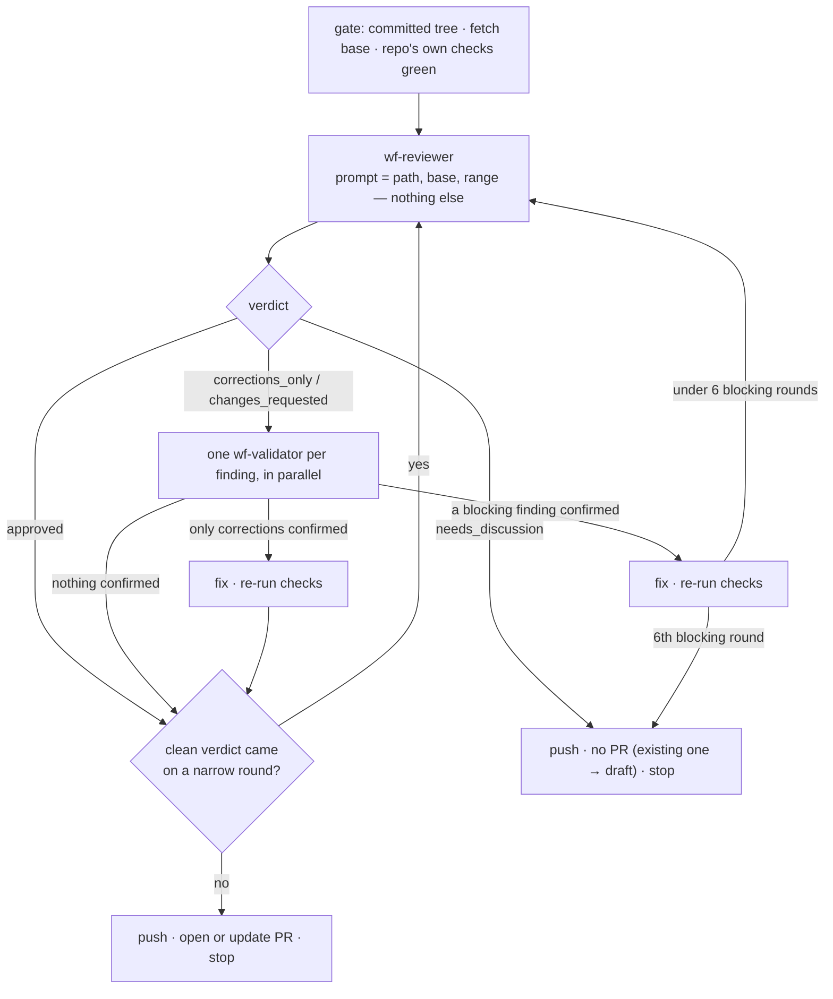
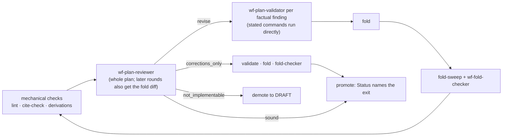

# claude-workflows

Agentic development workflows for [Claude Code](https://claude.com/claude-code), installed
once per user and usable in any project: implement a change and have it independently
reviewed into a PR; or plan a feature, have the plan attacked by clean-context reviewers,
and conduct it to merged across one or several repos.

The idea underneath all of it: **the party that did the work never judges it.** Code is
reviewed by a subagent that has no memory of writing it and is told nothing about it; every
finding is checked by a second subagent before anyone acts on it; plans are attacked by a
reviewer that didn't write them; and "is it done?" is answered by a verifier that took no
part. The orchestrating session only routes.

Everything is prefixed `wf-` so it can't collide with built-in commands (`/code-review`) or
plugin agents (`code-reviewer`).

## What's inside

**Skills** (invoke as `/wf-…` or let Claude pick them from the description)

| Skill | Does | Use when |
| --- | --- | --- |
| `wf-implement` | implements a task, then hands off to `wf-review-loop` | "implement / add / fix X" — any PR-sized change |
| `wf-review-loop` | reviewer → validators → fix → repeat until clean, then opens or updates the PR and stops | a branch already has the changes |
| `wf-sync-main` | merges the default branch into an in-flight branch, resolves conflicts, re-checks the branch against what arrived | a PR is stale or conflicting |
| `wf-plan` | researches a feature, asks you the product calls, writes a plan with a DAG of PR-sized nodes, runs the plan-review loop, presents it | a feature too big for one PR |
| `wf-conduct` | verifies what landed, launches implementer subagents wave by wave, runs a merge queue per repo, closes the plan out | an approved plan should be built |
| `wf-verify-plan` | re-reads the trees to say what a plan actually shipped, rewrites its Status, files it under `done/`, hands off the rest | "is this plan done?" |
| `wf-product-analysis` | market, competitors, demand, inventory from code, gaps, next moves | "how do we stack up / what next?" |

**Agents** (spawned by the skills, never by hand)

| Agent | Model / effort | Role |
| --- | --- | --- |
| `wf-reviewer` | inherits the session | open-ended hunt over one diff range; read-only |
| `wf-validator` | sonnet | confirms or refutes one code finding |
| `wf-plan-reviewer` | opus / xhigh | five passes over a plan: citations, externals, sequencing, completeness, reasoning |
| `wf-plan-validator` | sonnet | confirms or refutes one citation / external / completeness finding |
| `wf-fold-checker` | opus / medium | checks one edit made to a plan against the trees and the rest of the plan |
| `wf-verifier` | opus / high | establishes what a plan landed; proposes its `## State` block |
| `wf-implementer` | opus / medium | builds one plan node in its own worktree, through `wf-implement`, ending at a PR |
| `wf-implementer-high` | opus / high | the same, for migrations, auth, data rewrites, breaking contracts |

**Shared references** in `reference/` — the single home of each rule the skills and agents
share; nothing restates them.

| File | Defines |
| --- | --- |
| `project-docs.md` | where a project's rules live (`AGENTS.md`, `CLAUDE.md`, `CONTRIBUTING.md`, `DECISIONS.md`, `README.md`) and how to treat each |
| `workspace.md` | workspace root, plans repo, node repos, default branch, worktree and branch names, `gh -R` |
| `plan-format.md` | the plan document: Status block and ledger, `## State` DAG, node kinds, statuses, optional sections |
| `plan-review-loop.md` | the loop `wf-plan` and `wf-conduct` run over plans |
| `implementer-protocol.md` | everything an implementer agent does |

**Scripts** in `bin/` — deterministic checks the skills run instead of spending a reviewer
round on them. Each has a header with usage and exit codes, and a `.test.sh` beside it.

| Script | Does |
| --- | --- |
| `wf-plan-lint.sh <plan>` | checks the `## State` block, the Status block against it, and self-counts in the prose |
| `wf-plan-ledger.sh <plan> [--write]` | renders the Status ledger from the `## State` block |
| `wf-plan-cite-check.sh [--drift N] [--strict] <plan>` | checks every `file:line` citation and the symbol beside it against `origin/<default>` |
| `wf-plan-fold-diff.sh <plan> [<base>]` | writes the diff of one plan edit for `wf-fold-checker` |
| `wf-plan-fold-sweep.sh [--all] [--rare N] <plan> <diff>` | lists where values an edit removed still stand in the plan |
| `wf-merge-monitor.sh [--once] <repo> <branch>…` | polls a repo's PRs and prints the merge-queue head when it changes |
| `wf-lib.sh` | shared functions the scripts source: workspace root, plans directory, default branch, GitHub slug |

The scripts find the workspace root from the plan path you give them; with a plans directory
named anything other than `plans`, set `WF_WORKSPACE` to the root.

## Install

Requirements: Claude Code; `git` 2.31+; the GitHub CLI `gh`, authenticated (`gh auth
status`); `jq`; and for the scripts `bash` 3.2+, `awk`, `perl` (`wf-plan-fold-sweep.sh`) and
`ruby` (`wf-plan-lint.sh`) — all present on a stock macOS with Homebrew's `gh` and `jq`.

```bash
git clone git@github.com:aleskiontherun/claude-workflows.git ~/github/aleskiontherun/claude-workflows
```

```bash
~/github/aleskiontherun/claude-workflows/install.sh
```

The installer symlinks, so a `git pull` in the checkout is an upgrade:

| Link | Target |
| --- | --- |
| `~/.claude/wf` | the checkout — skills and agents read `~/.claude/wf/reference/*` and run `~/.claude/wf/bin/*` |
| `~/.claude/skills/wf-*` | `skills/wf-*` |
| `~/.claude/agents/wf-*.md` | `agents/wf-*.md` |

It is idempotent, moves anything real it would replace into `~/.claude/.backups/<timestamp>/`,
and prunes links to skills that were removed or renamed. `--dry-run` shows what it would do;
`--uninstall` removes only links that point into this checkout. Start a new Claude Code
session afterwards so the skills and agents are loaded.

Run the script tests after changing a script:

```bash
~/github/aleskiontherun/claude-workflows/bin/run-tests.sh
```

## How it reads your project

Nothing here knows about a particular project. Each skill and agent looks for, and follows,
what the project ships (`reference/project-docs.md` is the full rule):

- **`AGENTS.md` / `CLAUDE.md`** (any case, at the repo root, in ancestor directories, and in
  subdirectories for the files they govern) — conventions; they bind, and a rule cited in a
  finding must be quoted from one. `@imports` are followed.
- **`CONTRIBUTING.md`** — the lint, type-check and test commands that gate every review, and
  their environment caveats. Without one: `README.md`, then the build manifest and CI
  workflows, said to be inferred.
- **`DECISIONS.md`** (or `docs/adr/`) — grepped before any reviewer or validator calls a choice
  wrong; only appended to where the project's docs say entries belong.
- **`README.md`** — conventions and commands when the others are silent.

A repo with none of these is not treated as broken, and the workflows never add the files on
their own. Where the project's docs disagree with a default here (PR title format, base
branch, PR body shape), the project wins.

## Usage

### One change, reviewed into a PR

```
/wf-implement add rate limiting to the login endpoint
```

Claude works out which repo the change belongs to, reads its rules, implements on a branch
cut from `origin/<default>`, runs the repo's own checks, then runs `wf-review-loop`:



Rounds alternate between the whole branch (`<base>...HEAD`) and just the latest fixes
(`<sha>..HEAD`), and the loop only exits clean on a whole-branch verdict. It never merges;
it ends by naming the exit (`approved at <sha>`) and relaying what the reviewer checked.

Already have a branch? `/wf-review-loop`. Main moved under it? `/wf-sync-main`, which hands
back to the review loop.

A repo that takes no PRs (no GitHub remote, or its docs say so) runs the same loop on a
branch and ends with a push instead of a PR.

### A feature, planned and conducted

**1. Choose where plans live**, once per project. `wf-plan` offers this the first time and
asks which:

- **Workspace repo** — a private git repo that tracks `plans/`, with the code checkouts
  nested inside it as untracked directories. For products spread over several repos, or
  private plans for public code.
  ```
  ~/work/acme/          git repo: CLAUDE.md, plans/
    acme-api/           its own repo
    acme-web/           its own repo
  ```
- **Single repo** — `plans/` inside your code checkout is its own small git repo, excluded via
  `.git/info/exclude`. Nodes say `repo: .`.

Plans never live in a code repo's own history: the conductor rewrites a plan's state on every
transition, and those commits would otherwise land on your default branch without a PR. And a
code repo never references a plan — nobody else's clone has it.

**2. Plan it.**

```
/wf-plan account deletion with a 30-day grace period
```

The planner fans research out to subagents, asks you the product calls (and how the review
loop may proceed at a cap), writes `plans/account-deletion.md` — prose, owner decisions, and a
`## State` block of PR-sized nodes with `needs` edges — and runs the plan-review loop:



Two blocking rounds is a cap that goes back to you, unless the plan records your policy for
caps. You approve the plan; nothing launches before that.

**3. Conduct it.**

```
/wf-conduct plans/account-deletion.md
```

The conductor verifies what has already landed (a `wf-verifier`, never its own memory),
launches every node whose dependencies are merged — in parallel, each implementer in its own
worktree under `<repo>/.claude/worktrees/` — and keeps one merge queue per repo. You see one
line per repo and get one notification when its head is ready:

```
acme-api — next: #114 `feat(users)!: account deletion` — ready to merge (1 queued behind)
```

You merge. The conductor records it, has the next head synced, and launches the wave that
merge unblocked. Implementers that need a decision come back with questions it puts to you;
plan sentences an implementer found wrong are corrected before the next wave. After the last
merge it walks the plan's live `## Verification` scenarios, has a fresh verifier confirm, and
with your go-ahead rewrites the Status and moves the plan to `plans/done/`.

**4. Check any plan, any time.**

```
/wf-verify-plan account-deletion
```

### Product analysis

```
/wf-product-analysis
```

## Notes

- **Read-only agents are an instruction, not a sandbox.** The parenthetical Bash patterns in
  the agents' `tools:` frontmatter are not enforced as permission rules; if you want the
  guarantee, add `deny` rules in `~/.claude/settings.json`.
- **Claude Code tools the skills rely on**: `AskUserQuestion` (`wf-plan`, `wf-conduct`),
  `SendMessage` and `TaskStop` (`wf-conduct`, to resume implementers and replace monitors),
  and `Monitor` with `PushNotification` for the merge queue — without those two, run
  `wf-merge-monitor.sh --once` whenever you want the queue's state. A `Monitor` expires after
  at most 30 minutes; `wf-conduct` re-arms it. The desktop app's session tools are optional,
  for hand-offs.
- **Model pins use family aliases** (`opus`, `sonnet`), so they track the newest model in each
  family. `wf-reviewer` inherits the session model on purpose; the review loop reports the tier
  when it's below the strongest.
- **Paths are fixed at `~/.claude/wf/`.** Skills and agents read references and run scripts
  from there, so keep the installer's link in place.

## Migrating from the OpenDiving workflows

This kit is those workflows made project-agnostic. If you used them, the mapping is:

| OpenDiving | Here |
| --- | --- |
| `implement-with-review`, `code-review-loop`, `sync-with-main` | `wf-implement`, `wf-review-loop`, `wf-sync-main` |
| `opendiving-plan`, `opendiving-conduct`, `opendiving-verify-plan`, `opendiving-product-analysis` | `wf-plan`, `wf-conduct`, `wf-verify-plan`, `wf-product-analysis` |
| `reviewer`, `validator`, `plan-reviewer`, `plan-validator`, `fold-checker`, `verifier`, `implementer`, `implementer-high` | the same names with `wf-` |
| `plans/README.md`, `claude/plan-review-loop.md`, `implementer-protocol.md` | `reference/plan-format.md`, `reference/plan-review-loop.md`, `reference/implementer-protocol.md` |
| `claude/bin/plan-*.sh`, `merge-monitor.sh` | `bin/wf-plan-*.sh`, `bin/wf-merge-monitor.sh` |
| the umbrella repo | a workspace repo (`reference/workspace.md`) |

Section numbers changed: `wf-conduct` is §1–§6 (pickup §2, launch §3, returns and mid-flight
folds §4, merge queue §5, close-out §6).
